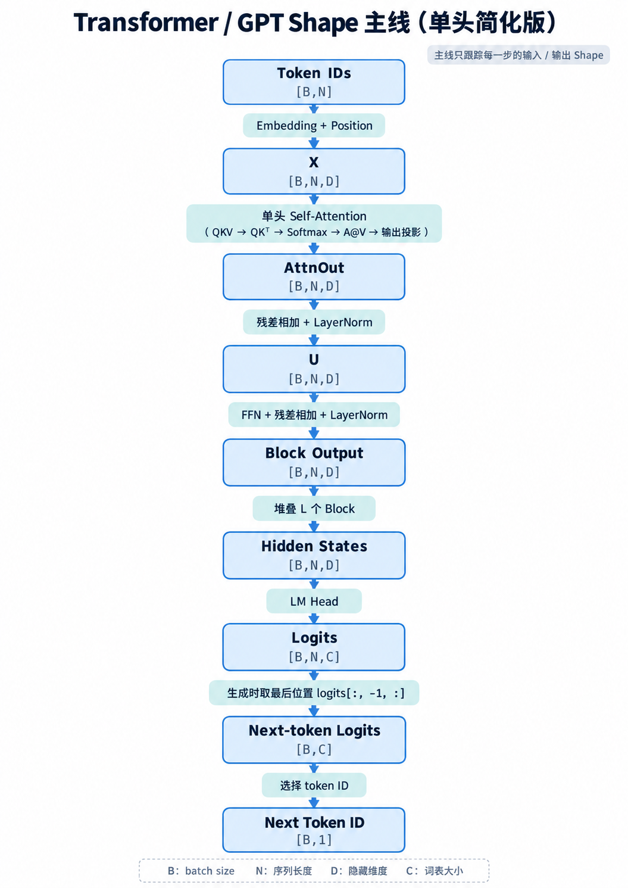
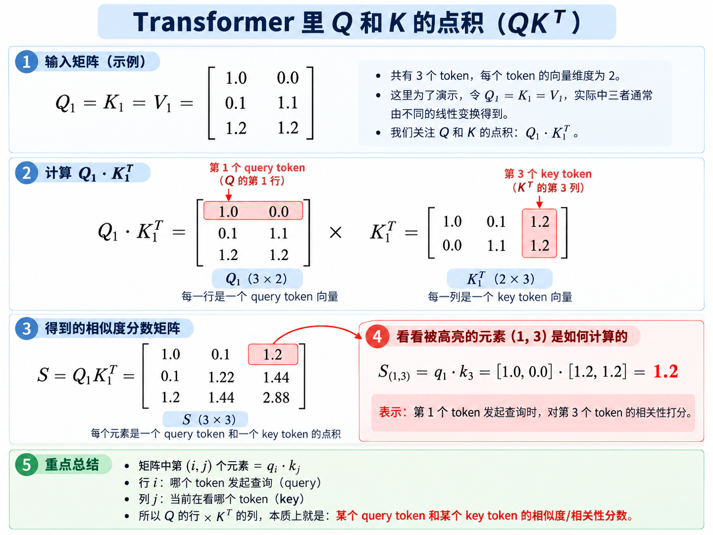
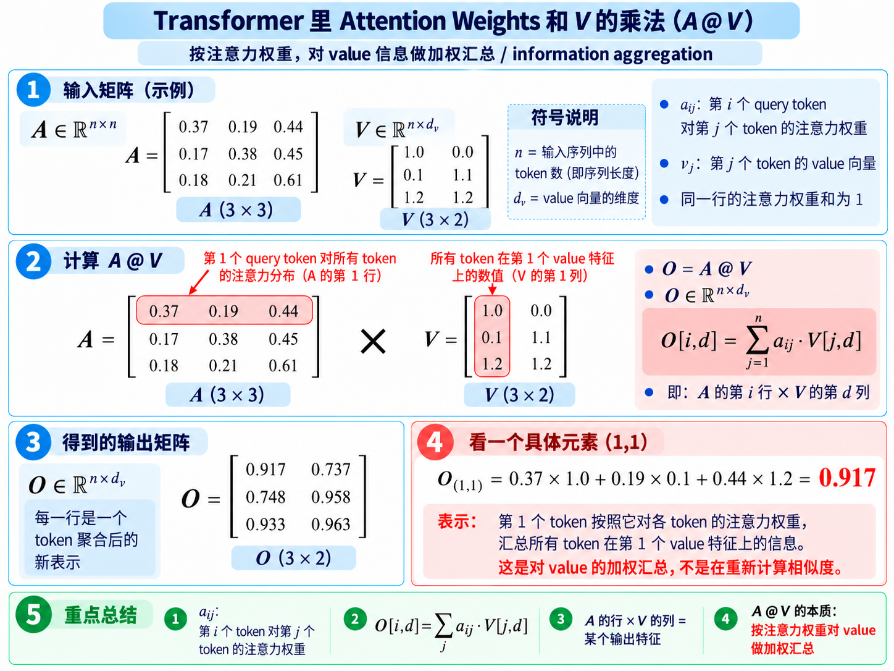
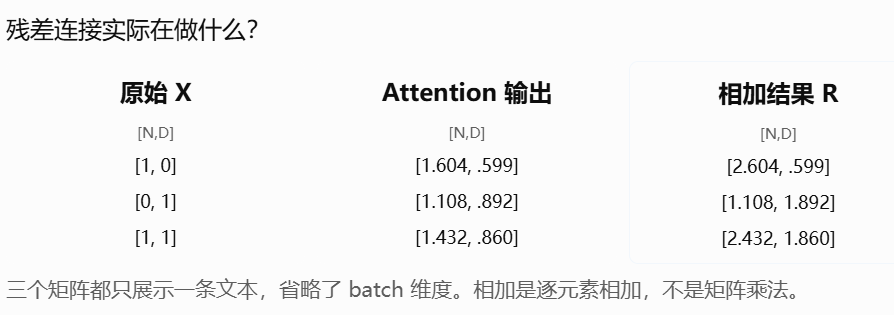
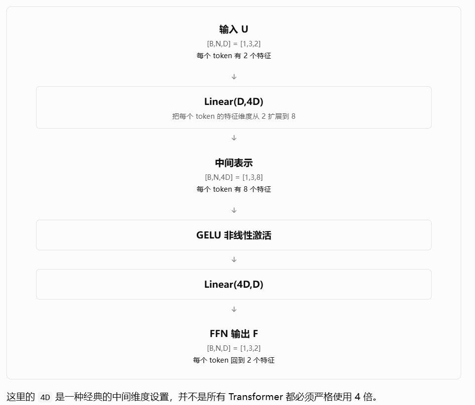
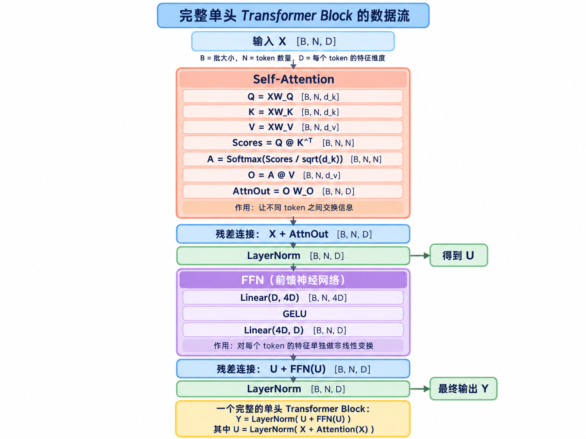
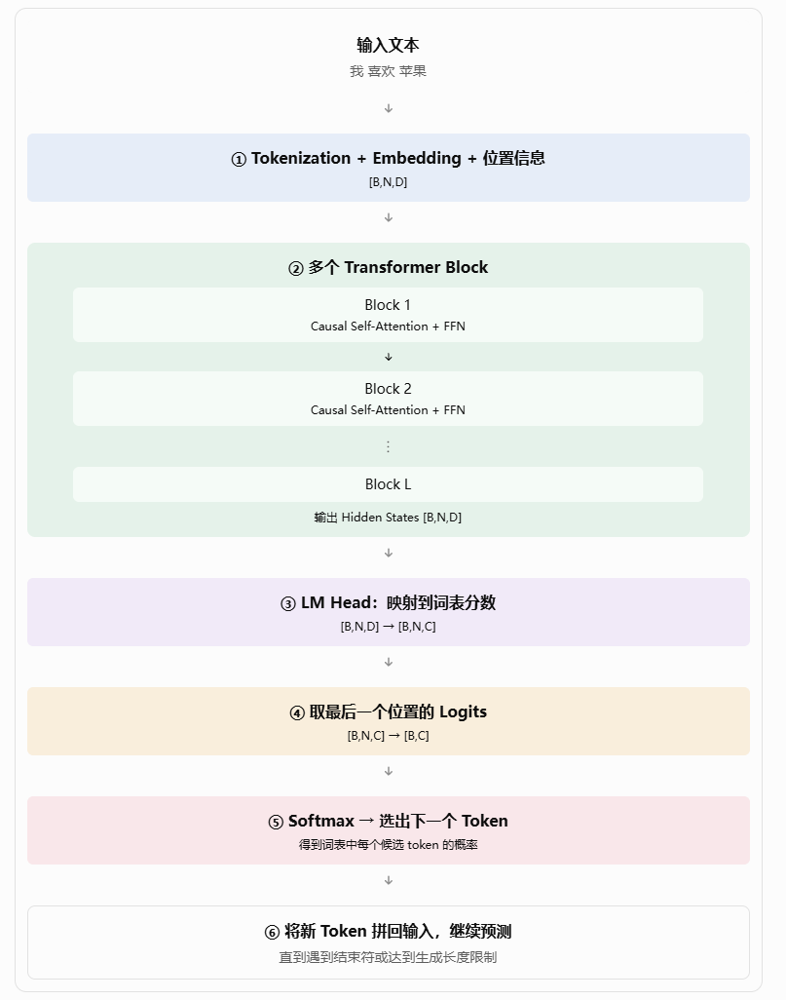
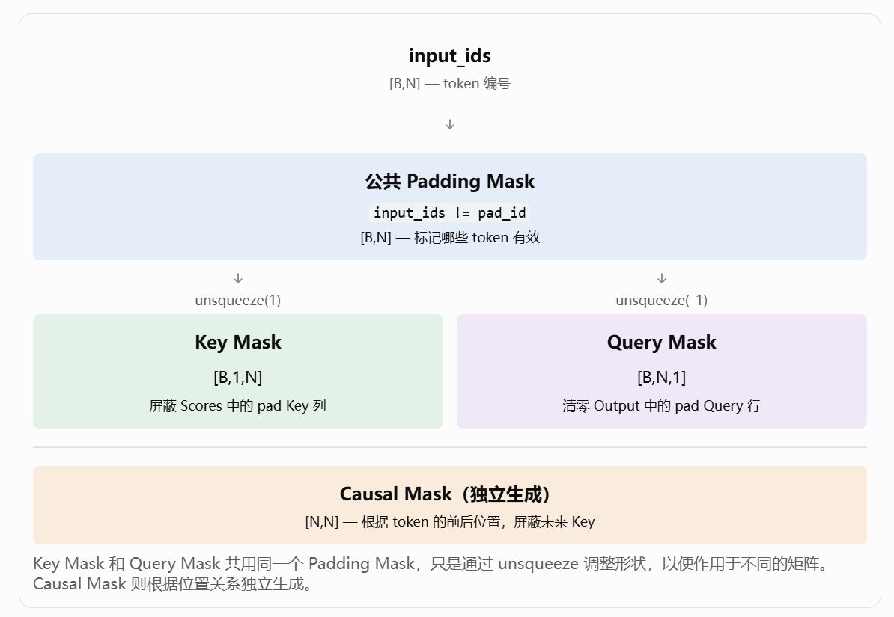

目标：根据已有 token 预测下一个 token。本文使用**单头、Post-LN 的简化 Decoder-only 模型**串起计算主线；多头和其他结构留到进阶笔记。

| 符号 | 含义 | 贯穿示例 |
| --- | --- | --- |
| B | 一个 batch 中的序列数 | 1 |
| N | 每条序列的 token 位置数 | 3 |
| D | 每个 token 的隐藏向量维度 | 2 |
| C | 词表大小（vocab_size） | 4 |
| L | Transformer Block 层数 | 2 |

### Shape 主线（先记整体）

这条主线只跟踪每一步的输入和输出 Shape；模块内部的计算在下面展开。单头示例统一取 `d_k = d_v = D = 2`，因此 Attention 输出可以与 `X` 做残差相加。GPT 需要因果信息限制，Mask 放在第六章补充。

## 一、输入模型前的前奏

##### 1. 句子 → Token → Token ID

`tokenizer` 根据切分规则和词表，将文本编码成 token ID。BPE 是一种常见的词表构建方法：从字符或字节等初始符号出发，反复合并频繁相邻的片段。

以下为简化示意，具体切分方式取决于 tokenizer：

```text
文本：我喜欢苹果
tokens：['我', '喜欢', '苹果']
token_ids：[[0, 1, 2]]          # [B,N] = [1,3]
```

##### 2. Token ID → Embedding

Embedding 是按 token ID 查可训练参数表。**参数表没有 Batch 维度**，其 Shape 是 `[C,D]`；一次查表的输出才是 `[B,N,D]`。

```python
import torch

# 本例词表 C=4，隐藏维度 D=2（仅作查表示意）
E = torch.tensor([
    [1.0, 0.0],  # id 0
    [0.0, 1.0],  # id 1
    [1.0, 1.0],  # id 2
    [0.2, 0.4],  # id 3
])                   # [C,D] = [4,2]

token_ids = torch.tensor([[0, 1, 2]])  # [B,N]
token_embeddings = E[token_ids]         # [B,N,D] = [1,3,2]
```

Embedding 表在训练中通过反向传播更新，已训练模型则从参数文件加载已学习的权重。QKV 投影、FFN 等参数也通过训练学习。

##### 3. 加入位置信息

以**可学习的绝对位置 Embedding** 为例：

```python
# 假设 token_embedding 和 position_embedding 是已定义的 Embedding 层
position_ids = torch.arange(N).unsqueeze(0).expand(B, N)  # [B,N]
token_embeddings = token_embedding(token_ids)               # [B,N,D]
position_embeddings = position_embedding(position_ids)     # [B,N,D]
X = token_embeddings + position_embeddings                 # [B,N,D]
```

两者相加后 Shape 不变，模型输入 `X` 同时包含 token 信息与位置信息。其他位置编码方法另开笔记。

## 二、单头 Self-Attention

##### 1. 从 X 得到 Q、K、V

```python
# X: [B,N,D]；W_Q / W_K / W_V: [D,D]
Q = X @ W_Q         # [B,N,D]
K = X @ W_K         # [B,N,D]
V = X @ W_V         # [B,N,D]
```

三套投影矩阵是独立的可学习参数。

- `Q`（Query）：当前 token 用来查询信息的表示。
- `K`（Key）：各 token 用来匹配查询的表示。
- `V`（Value）：匹配后按注意力权重聚合的内容。

##### 2. 打分、归一化、融合 V

```python
Scores = Q @ K.transpose(-2, -1) / math.sqrt(D)  # [B,N,N]
A = torch.softmax(Scores, dim=-1)                 # [B,N,N]
O = A @ V                                        # [B,N,D]
```

- `Scores[b,i,j]`：第 `b` 条序列中，第 `i` 个 Query 与第 `j` 个 Key 的缩放匹配分数。
- `A[b,i,j]`：第 `i` 个位置从第 `j` 个位置读取 Value 的权重；同一 Query 行沿 Key 维度归一化。
- `O[b,i]`：第 `i` 个位置对所有 Value 加权求和后的新表示。
- 除以 `sqrt(D)` 是因为本例 `d_k=D`；一般写作 `sqrt(d_k)`，用于抑制高维点积的数值幅度。

**① Q @ Kᵀ 的计算图：**


**② A @ V 的计算图：**


本例 `O.shape = [B,N,D] = [1,3,2]`，与图中的二维 Value 向量一致。

##### 3. 输出投影

```python
AttnOut = out_proj(O)  # [B,N,D] → [B,N,D]
```

输出投影矩阵 Shape 为 `[D,D]`，把注意力聚合结果映射回模型隐藏空间。为沿用手算结果，本例假设输出投影为**无偏置恒等变换**，所以 `AttnOut = O`，两者都是 `[1,3,2]`。

# 三、残差连接、层归一化、前馈神经网络
###### 1.残差连接（Residual Connection）：
- 是什么？会把输入 X 与 Attention 输出相加：
$$
\boxed{R = X + \text{AttnOut}}
$$

- 为什么？
   1. 提供保留输入信息的直接路径（Attention的输出虽然包含融合后的上下文信息，但不意味着原始X中的所有信息都应被丢掉）
   2. 有助于训练深层网络（假设一个模型有很多层Transformer Block，如果每一层都只能把上一层的输出完全重新加工，深层模型的优化会很困难。残差连接提供了一条直接传递信息和梯度的路径，通常可以让深层网络更容易训练）
- shape？
$$
[B, N, D] + [B, N, D] = [B, N, D]
$$
   **残差连接不改变 token 数量，也不改变每个 token 的特征维度。**

###### 2.LayerNorm层归一化
- 是什么？
   1. 在对哪个维度归一化？
	   输入的shape：`R.shape = [B,N,D]`，LayerNorm(D) 处理的是最后一个维度 D，**对每个token自己的D个特征归一化**
   2. 归一化过程？
	 ① 计算均值：$\mu = \frac{1}{D}\sum_{j=1}^{D} x_j$
	 ② 计算方差：$\sigma^2 = \frac{1}{D}\sum_{j=1}^{D}(x_j - \mu)^2$
	 ③ 标准化：$\hat{x}_j = \frac{x_j - \mu}{\sqrt{\sigma^2 + \epsilon}}$
	 ④ 可学习的缩放与偏移：$y_j = \gamma_j \hat{x}_j + \beta_j$
	**符号含义：**
	- $D$：每个 token 的特征数量。
	- $x_j$：当前 token 的第 $j$ 个特征值。
	- $\mu$：当前 token 所有特征的均值。
	- $\sigma^2$：当前 token 所有特征的方差。
	- $\epsilon$：防止除零的小正数。
	- $\gamma_j, \beta_j$：可学习参数，分别控制缩放和偏移。

- 为什么？对每个 token 的特征做归一化，减小数值尺度变化对深层计算的影响。
- shape？
$$[B, N, D] -> [B, N, D]
$$
先给第一次残差连接和 LayerNorm 后的结果起一个名字：$U=LayerNorm(X+AttnOut)$
本例简化运算后：（但不代表真实的LayerNorm只能得到±1）
$$U\approx \begin{bmatrix} 1&-1\\ -1&1\\ 1&-1 \end{bmatrix}$$
###### 3.FFN前馈神经网络：对每个已融合上下文信息的 token 向量，单独进行进一步的非线性特征加工。
- 是什么？
```python
ffn = nn.Sequential(
	nn.Linear(D, 4 * D),
	nn.GELU(), # 或ReLU
    nn.Linear(4 * D, D) )
```
分成三步：

- 为什么？
  1. FFN作用：Attention仅仅把其他 token 的 Value 加权融合起来，并不能完成所有复杂的特征计算。FFN 可以利用学习到的参数，对融合后的向量进行更复杂的特征组合和变换。
 区分：FFN 实际上是对每个 token 独立应用同一套 Linear 和激活函数，它本身不负责 token 之间的信息交换，但是可以加工已经融合了上下文的 token 表示。
  2. 为何先升维再降维？如果只是做一次线性变换，得到的仍然只是原始特征的线性组合。但 FFN 先把它映射到更大的特征空间，再通过非线性激活，最后压回原来的维度。这样就能学习更丰富的非线性特征变换
- shape?
$$[B, N, D] -> [B, N, 4D] -> [B, N, D]$$

# 四、完整的Transformer Block
以下以**先残差相加，再 LayerNorm（Post-LN）** 的结构串起一个完整 Block。

先定义 Attention 的输出：
$$
\text{AttnOut} = \text{OutProj}\left(
\text{Softmax}\left(\frac{QK^T}{\sqrt{d_k}}\right)V
\right)
$$
然后：
$$
\boxed{U = \text{LayerNorm}(X + \text{AttnOut})}
$$
接着：
$$
F = \text{FFN}(U)
$$
最后：
$$
\boxed{Y = \text{LayerNorm}(U + F)}
$$
$Y$ 就是一个 Transformer Block 的最终输出。



# 五、GPT 预测下一个 token
完整流程：

**Transformer Block 加工各位置的隐藏向量，LM Head 才把隐藏向量映射成词表分数。** 本文只用单头简化计算；真实 GPT 类模型通常采用多头 Attention，Block 的归一化位置等实现细节也可能不同。
##### 1. Transformer Block → Hidden States
经过 Embedding 和位置信息处理后：`X.shape = [B,N,D]`
输入多个 Transformer Block，内部主要包含：
- Causal Self-Attention：通过因果限制，只融合当前位置及之前的信息（详见第六章）。
- FFN：对每个 token 的特征进行非线性变换。
- Residual + LayerNorm：提供残差路径，帮助深层网络稳定训练。
最终得到：`hidden_states.shape = [B,N,D]`
**Hidden States（隐藏状态）**：经过多个 Transformer Block 加工后的 token 向量，每个位置包含可用于预测下一个 token 的上下文信息。
**关键点：多个 Block 通常不会改变整体 shape**，而是不断更新每个 token 的特征表示。

##### 2. LM Head：Hidden States → Logits
Transformer Block 的输出还不是文字，需要通过 LM Head（语言模型输出层） 映射到词表。
LM Head 通常是一个线性层：
```python
lm_head = nn.Linear(D, C)        # [B,N,D] @ [D,C] = [B,N,C]
logits = lm_head(hidden_states)
```
矩阵计算（省略偏置）：
$$
\mathrm{Logits} = \mathrm{HiddenStates} \cdot W_{lm}
$$
Shape：
$$
[B, N, D] \cdot [D, C] = [B, N, C]
$$
输出的每个位置都会得到 $C$ 个分数，对应词表中的 $C$ 个候选 token。
**Logits 是原始预测分数，不是概率。** 如果需要概率，可以进行 Softmax：
$$
P = \mathrm{Softmax}(\mathrm{Logits})
$$
沿最后一个词表维度 C 计算，shape 不变。
```datacorejsx
const GREEN_BG = '#e3f1e9';
const GREEN_TEXT = '#468263';
const BORDER = '1px solid var(--background-modifier-border)';
const TOKENS = ['我', '喜欢', '苹果', '<eos>'];
const ROWS = [
  { input: '我', scores: [0, 2, -2, 0] },
  { input: '喜欢', scores: [0, 0, 2, -2] },
  { input: '苹果', scores: [0, -2, 0, 2] }
];

function softmax(scores) {
  const peak = Math.max(...scores);
  const exps = scores.map(x => Math.exp(x - peak));
  const total = exps.reduce((a, b) => a + b, 0);
  return exps.map(x => x / total);
}

return function View() {
  const [selected, setSelected] = dc.useState(0);
  const row = ROWS[selected];
  const maxScore = Math.max(...row.scores);
  const best = row.scores.indexOf(maxScore);
  const probabilities = softmax(row.scores);
  return (
    <div style={{ border: BORDER, borderRadius: '8px', padding: '14px', display: 'flex', flexDirection: 'column', gap: '10px' }}>
      <strong>交互：点击输入位置，查看该行的 softmax 概率（示意）</strong>
      <div style={{ display: 'flex', flexWrap: 'wrap', gap: '8px' }}>
        {ROWS.map((item, i) => (
          <button key={item.input} onClick={() => setSelected(i)} style={{ border: i === selected ? '2px solid var(--interactive-accent)' : BORDER, borderRadius: '6px', padding: '6px 10px', background: i === selected ? 'var(--background-secondary)' : 'var(--background-primary)', color: 'var(--text-normal)', cursor: 'pointer' }}>位置 {i}：{item.input}</button>
        ))}
      </div>
      <div style={{ overflowX: 'auto' }}>
        <table style={{ borderCollapse: 'separate', borderSpacing: '4px', width: '100%' }}>
          <thead>
            <tr>
              <th style={{ textAlign: 'left', padding: '4px 8px', color: 'var(--text-muted)', fontWeight: 500 }}>输入位置</th>
              {TOKENS.map(token => <th key={token} style={{ padding: '4px 8px', color: 'var(--text-muted)', fontWeight: 500 }}>{token}</th>)}
            </tr>
          </thead>
          <tbody>
            {ROWS.map((item, i) => (
              <tr key={item.input}>
                <th style={{ textAlign: 'left', padding: '4px 8px', fontWeight: 500 }}>{item.input}</th>
                {item.scores.map((score, j) => {
                  const isBest = score === Math.max(...item.scores);
                  return <td key={j} style={{ textAlign: 'center', padding: '7px 12px', borderRadius: '5px', background: isBest ? GREEN_BG : 'var(--background-primary)', color: isBest ? GREEN_TEXT : 'var(--text-normal)', fontWeight: isBest ? 700 : 400 }}>{score}</td>;
                })}
              </tr>
            ))}
          </tbody>
        </table>
      </div>
      <div style={{ background: 'var(--background-secondary)', borderRadius: '6px', padding: '10px 12px' }}>
        <div><strong>当前位置：</strong>{row.input}；<strong>最高 logits：</strong>{TOKENS[best]} = {maxScore}</div>
        <div style={{ marginTop: '6px', color: 'var(--text-muted)' }}><strong>softmax：</strong>{probabilities.map((p, i) => `${TOKENS[i]} ${p.toFixed(3)}`).join('　')}</div>
      </div>
    </div>
  );
};
```

##### 3.训练和生成的区别
```datacorejsx
const BLUE_BG = '#e7eef8';
const BLUE_TEXT = '#2f5f9e';
const GREEN_BG = '#e3f1e9';
const GREEN_TEXT = '#168a4b';
const BORDER = '1px solid var(--background-modifier-border)';
const INPUT = ['我', '喜欢', '苹果'];
const TARGET = ['喜欢', '苹果', '<eos>'];
const STEPS = [
  { context: ['我'], next: '喜欢' },
  { context: ['我', '喜欢'], next: '苹果' },
  { context: ['我', '喜欢', '苹果'], next: '<eos>' }
];

function TokenRow({label, tokens, background, color}) {
  return (
    <div style={{ display: 'grid', gridTemplateColumns: '76px 1fr', alignItems: 'center', gap: '8px' }}>
      <span style={{ color: 'var(--text-normal)' }}>{label}</span>
      <div style={{ display: 'flex', gap: '6px', flexWrap: 'wrap' }}>
        {tokens.map((token, i) => <span key={`${label}-${i}`} style={{ padding: '7px 14px', borderRadius: '6px', background, color, fontWeight: 600 }}>{token}</span>)}
      </div>
    </div>
  );
}

return function View() {
  const [step, setStep] = dc.useState(0);
  const current = STEPS[step];
  return (
    <div style={{ border: BORDER, borderRadius: '8px', padding: '14px', display: 'flex', flexDirection: 'column', gap: '14px' }}>
      <strong>交互：切换训练对齐与自回归生成步骤</strong>
      <div style={{ display: 'grid', gridTemplateColumns: 'minmax(260px, 1fr) minmax(260px, 1fr)', gap: '14px' }}>
        <div style={{ border: BORDER, borderRadius: '6px', padding: '12px', display: 'flex', flexDirection: 'column', gap: '8px' }}>
          <strong>训练：一次计算全部位置</strong>
          <TokenRow label="输入" tokens={INPUT} background={BLUE_BG} color={BLUE_TEXT} />
          <TokenRow label="预测目标" tokens={TARGET} background={GREEN_BG} color={GREEN_TEXT} />
          <span style={{ color: 'var(--text-muted)', fontSize: '0.9em' }}>第 i 个输入位置对应第 i 个 next-token 标签。</span>
        </div>
        <div style={{ border: BORDER, borderRadius: '6px', padding: '12px', display: 'flex', flexDirection: 'column', gap: '8px' }}>
          <strong>生成：每次追加一个 token</strong>
          <div style={{ display: 'flex', gap: '6px', flexWrap: 'wrap' }}>
            {STEPS.map((item, i) => <button key={i} onClick={() => setStep(i)} style={{ border: i === step ? '2px solid var(--interactive-accent)' : BORDER, borderRadius: '5px', padding: '5px 8px', background: i === step ? 'var(--background-secondary)' : 'var(--background-primary)', color: 'var(--text-normal)', cursor: 'pointer' }}>第 {i + 1} 次</button>)}
          </div>
          <TokenRow label="上下文" tokens={current.context} background={BLUE_BG} color={BLUE_TEXT} />
          <TokenRow label="新 token" tokens={[current.next]} background={GREEN_BG} color={GREEN_TEXT} />
        </div>
      </div>
      <div style={{ color: 'var(--text-muted)' }}>生成第 {step + 1} 个 token：读取当前上下文 → 计算最后位置 logits → 选择 `{current.next}` → 追加到上下文。</div>
    </div>
  );
};
```
1. **训练：并行预测所有位置**
   GPT 的训练目标是预测下一个 token，因此需要将输入和标签错位对齐（Shift）。
   训练时：
   - `logits.shape = [B,N,C]`：每个位置对词表的预测分数。
   - `labels.shape = [B,N]`：每个位置对应的正确下一个 token ID。
   例如输入 `[我, 喜欢, 苹果]`，对应标签为 `[喜欢, 苹果, <eos>]`。使用 `CrossEntropyLoss` 计算预测损失，并通过反向传播更新模型参数。
   注意：CrossEntropyLoss 直接接收 Logits，不需要手动 Softmax。
2. **生成：自回归逐个预测**
   生成时，模型只需要最后一个位置的预测结果。

```python
# 取最后一个位置的词表分数([:, -1, :]表示保留所有 batch、取最后一个 token 位置、保留全部 C 个词表分数。)
next_logits = logits[:, -1, :]   # [B,C]

# 贪心解码：选择最高分的 token
next_id = next_logits.argmax(
    dim=-1, keepdim=True
)  # [B,1]

# 拼回当前输入
input_ids = torch.cat(
    [input_ids, next_id], dim=1
)  # [B,N+1]
```

# 六、Attention Mask：Padding Mask 与 Causal Mask
关系图：

##### 1. 为什么需要 Mask？
Self-Attention 默认允许每个 token 关注序列中的所有 token，但有些位置不应该被关注，因此需要 Mask 来限制信息流动。

主要有两类：
- **Padding Mask**：屏蔽无效的 `<pad>` 位置。
- **Causal Mask**：屏蔽未来位置，防止自回归预测时偷看答案。

**实现原理：** 在 Softmax 之前，将 Scores 中需要屏蔽的位置设置为 `-inf`，由于 `exp(-inf)=0`，经过 Softmax 后，这些位置的注意力权重就会变成 0。

##### 2. Padding Mask（填充掩码）
1. 为什么需要？一个 batch 中不同文本的 token 数量可能不同，因此通常需要用 `<pad>` 将序列补齐到相同长度。例如：`["我", "喜欢", "苹果", "<pad>", "<pad>"]`后两个 `<pad>` 只是占位符，不具有实际语义，因此不应该作为有效信息参与 Attention。
2. 分类：Key Mask 和 Query Mask
3. 公共基础：padding_mask。首先标记哪些 token 是真实的、哪些是 pad。
```python
padding_mask = (input_ids != pad_id)  # [B,N]
# [[True, True, True, False, False]]
```

- `True`：有效 token。
- `False`：pad token。
**注意：padding_mask 只是有效性标记，它本身还没有决定要屏蔽 Scores 的列，还是清零 Output 的行。**
后续 Key Mask 和 Query Mask 都由它生成。
###### 2.1 Key Mask：不允许关注 pad
1. 是什么？
  已知：`Scores.shape = [B, N_Query, N_Key]`，其中第一个 N 对应 Query 行，第二个 N 对应 Key 列。
  由于我们需要屏蔽 Key 列，因此：
```python
key_mask = padding_mask.unsqueeze(1)    # [B,N] → [B,1,N]
Scores = Scores.masked_fill(
    ~key_mask, float("-inf")
)
```
   `unsqueeze(1)` 在中间增加一个大小为 1 的维度，使同一组 Key 有效性标记广播到所有 Query 行。
   **结果：** pad 对应的 Scores 列被设置为 `-inf`，经过 Softmax 后，pad 的注意力权重为 0。

2. **作用：禁止 Query 从 pad 对应的 Key 位置读取信息。**

##### 2.2 Query Mask：清零 pad 位置的输出（可选）
1. 是什么？
  此时输出投影后的 `AttnOut.shape = [B,N,D]`，其中 `D` 是每个 token 的隐藏特征维度。
```python
query_mask = padding_mask.unsqueeze(-1)  # [B,N] → [B,N,1]
AttnOut = AttnOut * query_mask            # [B,N,D]，在输出投影后清零
```

- 真实 token：乘以 1，保留输出。
- pad token：乘以 0，输出清零。
   `unsqueeze(-1)` 在最后增加一个大小为 1 的维度，使有效性标记广播到每个 token 的全部 `D` 个特征。
2. **作用：将 pad 自己作为 Query 时产生的最终注意力输出清零。**
3. 为什么需要？
  因为 Key Mask 只限制“哪些 Key 可以被读取”，并没有阻止 pad 自己作为 Query，去读取真实 token 的 Value。因此，pad Query 仍可能得到非零输出。

**注意：** Query Mask 不是所有 Transformer 实现都必需的。如果后续层屏蔽 pad Key、损失忽略 pad 位置，通常可以不在每层清零。若要保证注意力子层的最终输出为零，应在可能带偏置的输出投影之后清零。

##### 3. Causal Mask（因果掩码）
1. 为什么需要？
GPT 等自回归语言模型需要根据已经出现的 token 预测下一个 token。如果当前位置能在 Attention 中读取未来的 token，就可能提前看到预测答案。
2. 是什么
- 因此，Causal Mask 要求：**第 i 个 Query 只能关注当前位置及之前的 Key。**
  允许关注的条件为：$j≤i$（ i：当前 Query 的位置， j：被关注的 Key 的位置。）
- **矩阵结构：**
  按贯穿示例 `N=3`：
$$
\begin{bmatrix}
1 & 0 & 0 \\
1 & 1 & 0 \\
1 & 1 & 1
\end{bmatrix}
$$
  这是一个包含主对角线的**下三角矩阵**。
    - `1`：允许关注。
    - `0`：禁止关注未来位置。
3. Shape 和代码
```python
causal_mask = torch.tril(
    torch.ones(N, N, dtype=torch.bool)
)# [N,N]

Scores = Scores.masked_fill(
    ~causal_mask, float("-inf")
)
```
   Causal Mask 的两个维度分别对应 Query 位置和 Key 位置。它可以广播到整个 batch 的 Scores `[B,N,N]`。
**结果：** 未来 Key 对应的分数被屏蔽，Softmax 后权重为 0。

##### 4. 三种 Mask 的区别
| Mask        | 操作对象             | Shape     | 作用        |
| ----------- | ---------------- | --------- | --------- |
| Key Mask    | Scores 的 Key 列   | `[B,1,N]` | 防止关注 pad  |
| Query Mask  | AttnOut 的 Query 行 | `[B,N,1]` | 清零 pad 输出 |
| Causal Mask | Scores 的未来位置     | `[N,N]`   | 防止偷看未来    |

**核心理解：**
- Padding Mask：按照 token 是否有效来限制信息。
- Causal Mask：按照 token 的先后位置来限制信息。
- Key Mask 与 Query Mask 共用同一个 `padding_mask`，但处理的对象不同。
```datacorejsx
const GREEN_BG = '#e3f1e9';
const GREEN_TEXT = '#468263';
const RED_BG = '#f6e3e7';
const RED_TEXT = '#c76f7a';
const BORDER = '1px solid var(--background-modifier-border)';

const MODES = [
  {
    name: 'Key Mask：屏蔽列',
    desc: 'Key 位置是 pad 时，所有 Query 都不能把注意力分给这一列。',
    columns: ['我', '喜欢', '苹果', 'pad', 'pad'],
    rows: [
      ['我', 1, 1, 1, 0, 0],
      ['喜欢', 1, 1, 1, 0, 0],
      ['苹果', 1, 1, 1, 0, 0],
      ['pad', 1, 1, 1, 0, 0],
      ['pad', 1, 1, 1, 0, 0]
    ],
    note: '对应 PyTorch 的 key_padding_mask：形状为 (N, S)，True 表示忽略对应 Key。'
  },
  {
    name: 'Query Mask：清零行',
    desc: 'Query 位置是 pad 时，不保留这一行的输出向量。',
    columns: ['d_v = 0', 'd_v = 1'],
    rows: [
      ['我', 1, 1],
      ['喜欢', 1, 1],
      ['苹果', 1, 1],
      ['pad', 0, 0],
      ['pad', 0, 0]
    ],
    note: '图中把 pad Query 的输出行写成 0；这一步是输出后处理，不等同于 key_padding_mask。'
  },
  {
    name: 'Causal Mask：屏蔽上三角',
    desc: '位置 i 只能关注位置 0 到 i，不能读取未来位置。',
    columns: ['0', '1', '2', '3', '4'],
    rows: [
      ['位置 0', 1, 0, 0, 0, 0],
      ['位置 1', 1, 1, 0, 0, 0],
      ['位置 2', 1, 1, 1, 0, 0],
      ['位置 3', 1, 1, 1, 1, 0],
      ['位置 4', 1, 1, 1, 1, 1]
    ],
    note: '对应 PyTorch 的 attn_mask / is_causal：二值 mask 中 True 表示该 Query-Key 位置不允许注意力。'
  }
];

function Mark({ok, text}) {
  return (
    <td style={{ padding: '7px 12px', textAlign: 'center', background: ok ? GREEN_BG : RED_BG, color: ok ? GREEN_TEXT : RED_TEXT, borderRadius: '5px', minWidth: '62px', fontWeight: 600 }}>
      {text || (ok ? '✓' : '×')}
    </td>
  );
}

function Matrix({mode}) {
  return (
    <div style={{ overflowX: 'auto' }}>
      <table style={{ borderCollapse: 'separate', borderSpacing: '4px', width: '100%', marginTop: '6px' }}>
        <thead>
          <tr>
            <th style={{ color: 'var(--text-muted)', fontWeight: 500, textAlign: 'left', padding: '4px 8px' }}>Query \\ Key</th>
            {mode.columns.map(c => <th key={c} style={{ color: 'var(--text-muted)', fontWeight: 500, padding: '4px 8px' }}>{c}</th>)}
          </tr>
        </thead>
        <tbody>
          {mode.rows.map((row, i) => (
            <tr key={row[0]}>
              <th style={{ color: 'var(--text-normal)', fontWeight: 500, textAlign: 'left', padding: '4px 8px', whiteSpace: 'nowrap' }}>{row[0]}</th>
              {row.slice(1).map((value, j) => <Mark key={j} ok={Boolean(value)} text={mode.name.startsWith('Query') ? (value ? '保留' : '0') : undefined} />)}
            </tr>
          ))}
        </tbody>
      </table>
    </div>
  );
}

return function View() {
  const [selected, setSelected] = dc.useState(0);
  const mode = MODES[selected];
  return (
    <div style={{ border: BORDER, borderRadius: '8px', padding: '14px', display: 'flex', flexDirection: 'column', gap: '10px' }}>
      <strong>交互：点击切换三种 mask 的作用方向</strong>
      <div style={{ display: 'flex', flexWrap: 'wrap', gap: '8px' }}>
        {MODES.map((item, i) => (
          <button key={item.name} onClick={() => setSelected(i)} style={{ border: i === selected ? '2px solid var(--interactive-accent)' : BORDER, borderRadius: '6px', padding: '7px 10px', background: i === selected ? 'var(--background-secondary)' : 'var(--background-primary)', color: 'var(--text-normal)', cursor: 'pointer' }}>{item.name}</button>
        ))}
      </div>
      <div style={{ color: 'var(--text-muted)' }}>{mode.desc}</div>
      <Matrix mode={mode} />
      <div style={{ fontSize: '0.9em', color: 'var(--text-muted)' }}>{mode.note}</div>
      <div style={{ display: 'flex', gap: '12px', flexWrap: 'wrap', fontSize: '0.9em' }}>
        <span><span style={{ background: GREEN_BG, color: GREEN_TEXT, padding: '2px 7px', borderRadius: '4px' }}>✓</span> 允许 / 保留</span>
        <span><span style={{ background: RED_BG, color: RED_TEXT, padding: '2px 7px', borderRadius: '4px' }}>×</span> 屏蔽 / 清零</span>
      </div>
    </div>
  );
};
```

##### 5. 在单头 Self-Attention 中的使用顺序

以下是计算顺序示意，假设 `Q、K、V` 和输出投影层已生成，`causal_mask`、`padding_mask` 可为 `None`。

```python
clear_pad_query = False   # 可选：设为 True 时清零 pad Query
Scores = (Q @ K.transpose(-2, -1)) / math.sqrt(D)  # [B,N,N]

# 两种 Mask 都在 Softmax 之前作用于 Scores
if causal_mask is not None:                  # [N,N]，True 表示允许关注
    Scores = Scores.masked_fill(~causal_mask, float('-inf'))

if padding_mask is not None:                 # [B,N]，True 表示有效 token
    key_mask = padding_mask.unsqueeze(1)     # [B,1,N]
    Scores = Scores.masked_fill(~key_mask, float('-inf'))

A = torch.softmax(Scores, dim=-1)            # [B,N,N]
O = A @ V                                    # [B,N,D]
AttnOut = out_proj(O)                        # [B,N,D]

# 如果需要清零 pad Query，在输出投影之后执行
if clear_pad_query and padding_mask is not None:
    query_mask = padding_mask.unsqueeze(-1)  # [B,N,1]
    AttnOut = AttnOut * query_mask
```

注意：若某行所有 Key 均被屏蔽，直接用 `-inf` 后做 Softmax 可能产生无效值，应避免这种输入。

## 参考

- [Attention Is All You Need](https://arxiv.org/abs/1706.03762) — Vaswani 等，注意力、残差与位置表示的原始论文。
- [PyTorch: scaled_dot_product_attention](https://docs.pytorch.org/docs/stable/generated/torch.nn.functional.scaled_dot_product_attention) — 缩放点积和布尔 Mask 的官方 API 说明。

资料核对日期：2026-10-15
